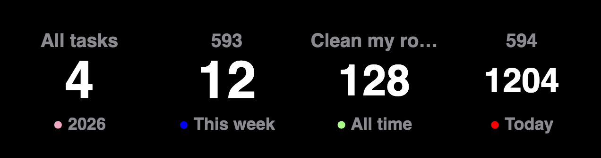
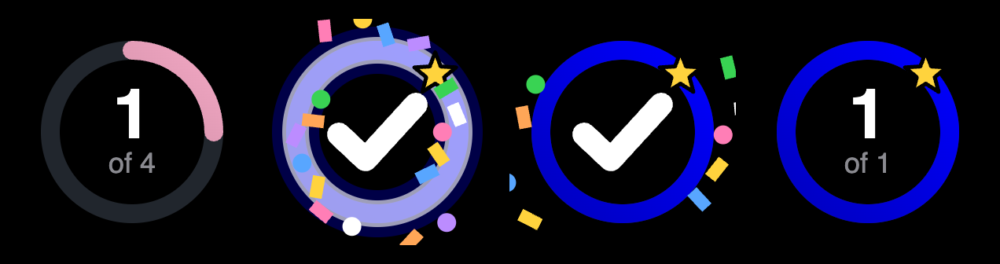
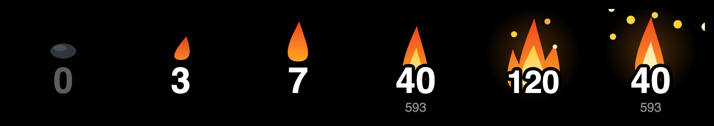
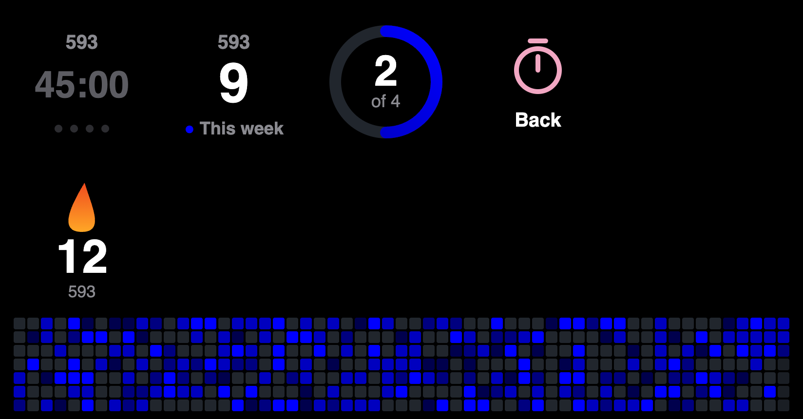

# A Pomodoro Timer on My Stream Deck

I wanted a focus timer I can start without picking up my phone or
finding a window. So it's a key: plain text, a countdown, and a dot for
every round. Each thing I time gets its own key with its own lengths
and its own color, whether that's a class, some research or cleaning my
room. A dial next to it shows a heat map of how much I've actually
focused.

| Action | What it does |
|---|---|
| ⏱ Timer | A key for one task. Tap to start, tap to pause, tap to carry on. Hold it for half a second for Done. Tap twice to jump to the break, or from a break back to focus. |
| 🟪 Heat Map | A dial. One square per day for the last 14 weeks, brighter for more focus time. Turn it to flip between all tasks and each one. Tap a task's map to open that task's page. Press it to jump to the break. |
| 🔢 Sessions | A key that counts my finished focus sessions, for one task or all of them. Press it to step through today, this week, this year and all time. |
| 🎯 Daily Goal | A key with a ring that fills as today's sessions get closer to my goal, and confetti the first time I get there. Once it's met, a press plays the confetti again. |
| 🔥 Streak | A key with how many days in a row I've focused, and a fire that grows with it, from an ember to a bonfire. Press it to make the fire flare. |
| ⏱ Open Pomodoro | A key that opens my main Pomodoro page on the deck it's on. On the task page it's the Back key. |


The key: waiting, counting, paused, and on a break. The dots are the
rounds. Finished ones are in the task's color and the gray one is the
round I'm in.


The strip above the dial: all tasks in pink, one task in its own color,
and the name that shows for a moment when I turn to it.

These pictures are drawn by the plugin's own drawing code, not
photographed off the deck.



The Sessions key: the task on top, the count, and which stretch of time
it's counting. The dot is the task's color.



The Daily Goal key: one of four done, the celebration, and a goal
that's met. The ring is the task's color, or pink for all tasks.



The Streak key at 0, 3, 7, 40 and 120 days, and a 40 day fire flaring.

## The pages

The plugin comes with three pages (Stream Deck calls them profiles):

| Page | Deck | What's on it |
|---|---|---|
| Pomodoro + | Stream Deck + | A Timer key and a Heat Map dial for each of my first three tasks, a fourth dial for all tasks, and Sessions, Daily Goal and Streak for all tasks |
| Pomodoro Task + | Stream Deck + | One task's page: its Timer, Sessions, Daily Goal and Streak, a Back key, and its heat map stretched across all four dials (a year and a month) |
| Pomodoro XL | XL | Everything at once: a row per task with Timer, Sessions, Daily Goal and Streak, and a row for all tasks |



The task page for one task, and the name that shows across the strip
when I turn to another.

Tapping a task's heat map on the + opens the task page for that task.
There's only one task page. Everything on it is set to "the task I
tapped", so it works for a task I add next week without building
anything. On the task page, turning any dial moves to the next task,
and tapping the strip goes back.

The Home keys are crossed over on purpose: the one on the + sends my XL
to its Home profile, and the one on the XL sends my + home.

## The settings

Everything is in the key's settings in the Stream Deck app (the
Property Inspector, the panel at the bottom).

| Setting | What it's for | If I leave it alone |
|---|---|---|
| Task | Which task this key times, picked from my task list. It's the name on the key and the name its focus time is saved under | Focus |
| Color | The picked task's color: its heat map, and its time on the key during a break. It belongs to the task, so it's the same on every key for that task | Pink |
| New task | Type a name and press Add. It goes on the list and this key switches to it | |
| Interval timer | Off makes it one plain countdown with no breaks | On |
| Focus | Minutes per focus round | 45 |
| Rounds | Focus rounds before the long break, 1 to 8 | 4 |
| Short break | Minutes, after each round but the last | 10 |
| Long break | Minutes, after the last round | 15 |
| Auto start | Start the next focus or break by itself | Off |
| Double tap | Tap twice to jump to the break | On |

To time a second thing, I drag another Timer key onto the deck and pick
a different task, or add a new one right there.

The Sessions key has two: Task (all tasks, or one from the list) and
Count (today, this week, this year or all time).

The Daily Goal key has two: Task, and Daily goal (1 to 12 sessions,
4 until I change it).

The Streak key has three: Task, Streak mode (daily, weekdays only, or
weekly) and Grace days (how many missed days in a row a streak
survives, 0 to 3, 1 until I change it).

The Heat Map dial has one setting, Show: all tasks, or one task from
the same list. Turning the dial changes the same thing.

The task list is one list for the whole plugin. I used to type the name
into each key, and one slip of the finger made a second task with its
own empty heat map. A dropdown can't misspell.

## How it works

```
key press → presses.js (tap, double or hold?) → timer.js → history.js → sessions.json
                                                    ↓
                                          draw.js → key and dial
```

- `timer.js` is the countdown and the rounds. It remembers the clock
  time a period ends, not a count of seconds, so a late tick can't make
  it drift and a restart can't lose it.
- `presses.js` tells a tap from a double tap from a hold. Stream Deck
  only reports "down" and "up".
- `history.js` saves each finished focus session and adds them up per
  day for the map. It keeps the task list too.
- `draw.js` makes the pictures as SVG text. `goal.js` draws the Daily
  Goal key's ring and confetti.
- `streak.js` works out the streak from the day totals, and
  `flames.js` draws the fire.
- `animate.js` is one shared metronome for anything that moves. Stream
  Deck takes about ten pictures a second, and that's a budget for the
  whole plugin, so animated keys take turns.
- `index.js` is the only file that talks to Stream Deck. The table at
  the top of it says which gesture does what, so changing one is a one
  line edit.

## Choices I made

- **One timer at a time.** If one task is running, another task's key
  shows Stream Deck's yellow warning triangle and does nothing. I didn't
  want a stray press on the wrong key to end a session.
- **A forgotten timer lets go after an hour.** Only one task runs at a
  time, so a timer I paused and walked away from would block every
  other key until I found it. The hour is `GIVE_UP_MS` in
  `src/timer.js`.
- **Done saves what I actually did.** Hold the key 20 minutes into a 45
  and 20 minutes are saved. Paused time and break time never count.
- **Double tap is on trial.** With it on, a single tap takes a third of
  a second longer, because the key has to wait and see if a second tap
  is coming. If that bothers me, the checkbox turns it off and the dial
  press still jumps to the break.
- **A session is a round that ran to the end.** If I press Done or jump
  to the break early, the minutes still go on the heat map, but it
  isn't a session. Sessions saved before I kept track of that count if
  they're 25 minutes or longer.
- **A streak day is any day with focus time.** It doesn't have to be a
  full session, and today can't break a streak, because today isn't
  over. The fire has eight sizes: it changes at 1, 3, 7, 14, 30, 60,
  120 and 365 days, and a weekly streak counts a week as 7.
- **The map's shades are in units of my sessions.** Under 45 minutes in
  a day is the faintest, then 45, 90, and 180 or more. They're in
  `STEPS` in `src/history.js`.
- **History lives outside the plugin**, in
  `~/Library/Application Support/com.malikacodes.pomodoro/sessions.json`,
  because reinstalling a plugin replaces its folder.

## Setup

Mac only. It needs Stream Deck 7.1 or newer and Node.

```bash
npm install
streamdeck link com.malikacodes.pomodoro.sdPlugin
```

`streamdeck` is Elgato's CLI (`npm install -g @elgato/cli`). There's no
build step.

The three pages are built from my own task list and my Home profiles,
so they aren't in the repo:

```bash
npm run profiles
```

That writes them into the plugin folder. Stream Deck installs a page
the first time a key or a tap opens it, and asks first. Run it again
after adding a task, then remove the old page in Stream Deck's
preferences so the new one can install. After changing the code:

```bash
streamdeck restart com.malikacodes.pomodoro
```

Then drag Timer onto a key and Heat Map onto a dial. They're under
Pomodoro in the action list.

## Good to know

- Focus time is saved under the task's name. There's no way to rename
  or remove a task from the settings yet. The list is the `colors` part
  of `sessions.json`, and the plugin has to be stopped before editing it.
- Two keys on the same task are one timer. Either one controls it.
- If I switch a key to another task while its timer is running, the
  timer keeps going under the old task. Switching the key back gets me
  the controls again.
- A new Timer key starts on a task called Focus.
- Tasks are listed A to Z, on the dropdowns and when I turn the dial.
- The pages hold my first three tasks. A fourth task still works
  everywhere, it just has no column of its own until I make room.
- On the task page, the Timer key uses its own lengths (45, 4 rounds,
  10 and 15 unless I change them there), not the lengths on that task's
  key on the main page.
- A plugin can only open pages it ships with. That's why the Home keys
  are Stream Deck's own Switch Profile action and not mine.
- The profile files hold my decks' serial numbers, which is the other
  reason they're ignored by git.
- Changing a key's lengths while its timer is running takes effect the
  next time I start it, not mid round.
- With auto start off, the next period shows as "Paused" until I tap.
- Inside a dial stack the press belongs to the stack, so jumping to the
  break from the dial won't work there. The double tap still does.
- A plain countdown (interval timer off) has no break to jump to, so
  the double tap and the dial press do nothing on it.
- If my Mac was asleep (or the plugin was off) when a period ran out,
  the sound plays when it comes back and the next period starts from
  then. The session is filed under the time the round really ended, so
  a round that ran out at 11:45pm stays on that day.
- A timer that sits paused for an hour ends itself. That goes for a
  pause I forgot, and for a next round that waited an hour for a tap.
  The focus minutes up to the pause are saved. A timer that's counting
  never ends itself.
- There's no undo after Done yet.

## Tests

```bash
npm test
```

They cover the rounds and breaks, that paused time isn't counted,
partial sessions, one task at a time, picking a timer back up after a
restart, a round that ran out while the Mac slept, a timer that ends
itself, the task list, what counts as a session, the goal ring and its celebration, the
streak rules, the fire, the animation turns, the map across four dials,
the page layouts, taps against double taps against holds, the day totals and
shades, and that everything is drawn on pure black.
