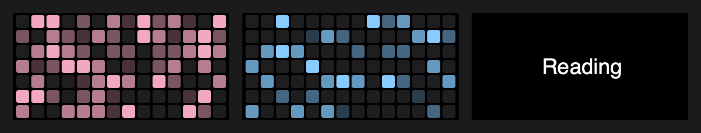
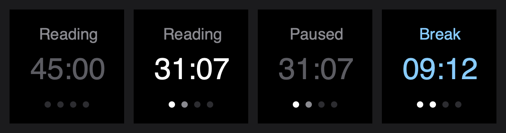

# 01 · A timer on a key

2026-10-10

I wanted a Pomodoro timer on my Stream Deck. A key with plain text like
my Speak Speed key, a dot for every round, and a dial that shows a heat
map of my focus time. This entry is the first build, from an empty
folder to both of them on the deck.

## What I wanted

- Tap to start and pause. Hold for Done.
- My usual numbers as the starting point: 45 minutes of focus, 4
  rounds, 10 minute breaks, a 15 minute long break. All of it
  changeable in the key's settings.
- A switch to turn the rounds off and get one plain countdown.
- A different timer for each thing I'm doing.
- A heat map per task, and one for everything.

> Do I need a different kind of key for every task?

No. It's one kind of key, and I drag it onto the deck once per task.
Each copy has its own name, color and lengths. The code has no idea
what a "class" is. A task is whatever I typed in the name box, which
means it works just as well for cleaning my room. (Less fun, same
timer.)

## Most of this already existed

This was mostly a raid on my own repos:

- The text key and the row of dots came from Speak Speed.
- The squares came from my GitHub Graph dial. 12px squares with a 2px
  gap, 14 weeks across one dial.
- Holding a key, the end-of-timer sound, and saving to a file outside
  the plugin came from another plugin of mine.

So the new parts were the timer itself and the taps.

## The timer keeps a clock time, not a count

My first idea of a timer is "subtract one every second". The trouble is
that a second on a computer isn't always a second. If one tick comes
late, the count is behind for good. And if the plugin restarts, the
count is gone.

So the timer doesn't count. It writes down the clock time the period
ends, and every second it asks "is it that time yet?". What's left is
just the end time minus now. Pausing saves how much was left, and
carrying on makes a new end time from it.

That also gave me the focus minutes for free:

```
focus minutes = how long the round is − how much is left
```

Paused time can't sneak in, because pausing doesn't change what's left.

## One at a time

If Reading is running and I press the Cleaning key, nothing happens
except Stream Deck's yellow warning triangle. I thought about letting
the second key take over, and decided against it: one stray press would
end my session. To change tasks I hold the running one for Done first.

## Tap, tap tap, and hold

Stream Deck only tells the plugin "key down" and "key up". Everything
else is timing:

- **Hold:** a half second timer starts when the key goes down. If it's
  still down when the timer fires, that's Done, right then, while my
  finger is still on it.
- **Tap:** the key came up before the half second.
- **Double tap:** a second press inside 300ms of the first.

The catch with the double tap is that the key can't know a tap is
single until 300ms pass with no second one. So with double tap on,
every pause is a third of a second late. I don't know yet if I'll mind.
There's a checkbox to turn it off, and pressing the dial jumps to the
break too, so I'm not stuck with it.

All three gestures are in one small table at the top of `index.js`:

```js
const KEY_GESTURES = { tap: "toggle", double: "skip", hold: "done" };
```

I'm not sure yet which features I'll keep, so I wanted changing my mind
to be cheap.

## Any color, five shades

Each task has a color, and the map needs five shades of it. I didn't
want to hand pick five for every color I might choose, so the shades
are made from the one color: 30%, 50%, 75% and all of it. "30% of a
color" just means multiplying its red, green and blue numbers by 0.3,
which is the same as mixing it with black.



All tasks in pink, one task in its own blue, and the name that shows
for a moment when I turn the dial to it.



The key: waiting, counting, paused, and on a break in the task's color.

## Midnight belongs to me

A session is filed under the day it ended, and the easy way to get a
date in JavaScript (`toISOString`) gives the date in UTC. An 11pm
session would have landed on tomorrow. The plugin builds the date from
my own clock, and there's a test with an 11pm session to keep it that
way.

## Did it work?

Before putting it on the real deck, I ran the plugin against a pretend
Stream Deck: a small script that sends the same "key down" and "dial
turned" messages the app does and prints what comes back. With a three
second focus round:

```
tap A: starts          Reading | 00:03
tap B while A runs     showAlert
tap A: pause           Paused  | 00:03
(1.5s later)           nothing drawn
focus runs out         Break   | 00:03   one white dot, one square lit
hold A                 showOk
```

On the deck, the check is:

1. Set a key's Focus to 1 and both breaks to 1, Rounds to 2.
2. Tap. It counts down in white with the first dot gray.
3. Tap again. It says Paused and goes gray.
4. Let a round run out. Glass sound, a notification, and the first dot
   turns white.
5. Tap twice quickly on a focus round. It jumps to the break.
6. Hold. A check mark, and the key goes back to waiting.
7. Turn the dial to the task. Today's square is lit in its color.

## What I learned

- A timer should remember when it ends, not how many seconds it has
  counted.
- A double tap isn't free. Something has to wait to find out.
- Dates have a time zone even when they don't look like it.

## What's next

- Use it for a week of real study sessions.
- Decide whether the double tap stays.
- Parked for later: the map stretched across all four dials, and an
  undo after Done.
