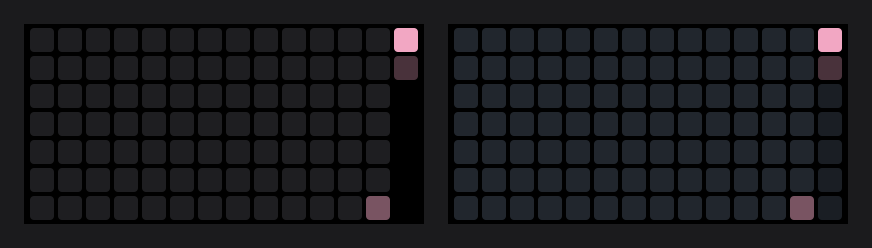

# 02 · The hole on Mondays

2026-10-12

My Pomodoro heat map sits right next to my GitHub Graph dial, and
today they didn't match. I fixed the wrong thing first.

## The wrong thing

I decided it was the color of the empty squares. Mine were a dark gray
I'd picked, `#1e1e21`, and GitHub Graph uses `#21262d` for a day with
nothing on it. So I changed mine to match.

Then I looked at the deck and couldn't see any difference. Which makes
sense: I'd swapped one nearly black gray for another nearly black gray.

## The actual thing

> Why is there a black stripe on the right?

It's Monday. The map only drew squares for days that have happened, so
this week's column was Sunday and Monday on top and then five squares
of nothing. On Saturday, when I built it, every column was full and
there was nothing to notice.

Before on the left, with the hole. After on the right.

The funny part is that I fixed this exact hole on GitHub Graph earlier
today. Same bug, same Monday, one dial to the left.

## The fix

Same as over there:

- The last column is always the whole week, Sunday to Saturday.
- Days that haven't happened yet get their own color, `#1a1e24`, one
  shade darker than an empty day. So I can still tell "not yet" from
  "nothing that day".
- A day after today is always drawn as upcoming, whatever the saved
  minutes say.

The drawing code has no clock in it, so it's handed today's date and
compares. Dates written like `2026-10-12` sort the same way words do,
which means `day > today` works on the text as it is.

I kept the empty color change too. It's small, but now both dials use
the same two dark squares.

## What I learned

- A bug that depends on the day of the week needs a test on that day of
  the week. There's a Monday in the tests now.
- Look at the picture before deciding what's wrong with it.
- That's twice in one day. That lesson keeps finding me.

## What's next

- A very dark task color could dim down to something close to the empty
  square. I haven't picked one that dark yet.
