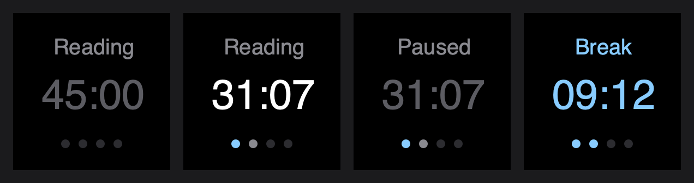

# 03 · One list of tasks

2026-10-13

Until today a task's name was typed into each Timer key. That's how I
ended up with tasks called "5" and "59" on the way to "593". Now there's
one task list, and the keys and the dial pick from it.

## Three ideas, one kept

> Could another key hold the tasks and hand them out to the others?

That was my favorite idea for about a minute. It would work, but it
spends a key on something I'd touch once a week, and a key is a bad
place to type a list.

I'd already solved this earlier today in my Canvas plugin: what
several keys share goes in one place, and each key is a dropdown. So:

- The list lives with the history, in the same file.
- The Timer key's settings have a Task dropdown, and a New task box
  with an Add button.
- The Heat Map dial got a settings page for the first time. One
  dropdown: all tasks, or one of them.

## The color moved house

A color used to belong to a key. Two keys on the same task could
disagree about it, and whichever I'd opened last would win.

Now the color belongs to the task. The color box on the settings page
doesn't save into the key at all. It tells the plugin "this task is
this color now", and every key and map for that task follows.

That's why the color box and the New task box are plain HTML and not
Elgato's components. Their components save into the key. These two
needed to send a message instead:

```
settings page → "add this task" → plugin → the list → every dropdown
```

The dots under the time followed. A finished round used to be a white
dot. Now it's the task's color, so a key and its heat map are the same
color story.



## My old keys

The keys already on my deck had their names and colors typed in. I
didn't want to set them all up again, so the first time a key shows
up, the plugin checks whether its task is on the list. If it isn't, it
goes on, with the color the key had. I ran the plugin against a pretend
Stream Deck with one of those old keys before letting it near the real
ones, and "593" kept its blue.

## The messages that went nowhere

The first time I tested the settings page messages, the plugin answered
with nothing at all. No list, no answer.

Nothing was broken. The plugin only sends to a settings page that's
open, and my pretend Stream Deck had never said "the page is open
now". One more message at the start (`propertyInspectorDidAppear`) and
everything arrived. The computer was right and I was talking to an
empty room.

## What it doesn't do yet

- There's no way to remove or rename a task from the settings. For now
  that's a careful edit of the file with the plugin stopped.
- If I switch a key to another task while its timer runs, the timer
  stays with the old task. Switching back gets me the controls again.

## What I learned

- A list that more than one key needs belongs to the plugin, not to a
  key. That's twice in one day I've built the same thing.
- A dropdown can refill itself: with `hot-reload` on, it listens for
  its list and redraws whenever the plugin sends a new one.
- A plugin can't talk to a settings page that isn't open.

## What's next

- A way to remove a task, so "5" and "59" can finally go.
